# Gebruikershandleiding — Kas Waarnemingen

> **Versie:** 1.0.0-rc.1  
> **Datum:** 26 mei 2026  
> **Doelgroep:** Kasmedewerkers en oogsthelpers  
> **Verwante documenten:** `../design/operatorObservationStrategy.md` (achtergrond), `../design/functionalRequirements.md` (FDS), `adminManual.md` (beheerdershandleiding, Engels — zelfde map)

---

## Inhoudsopgave

1. [Wat is Kas Waarnemingen?](#1-wat-is-kas-waarnemingen)
2. [Eerste keer gebruiken](#2-eerste-keer-gebruiken)
3. [Het startscherm](#3-het-startscherm)
4. [Een waarneming invoeren](#4-een-waarneming-invoeren)
5. [Het bevestigingsscherm](#5-het-bevestigingsscherm)
6. [Recente waarnemingen bekijken](#6-recente-waarnemingen-bekijken)
7. [Volledige geschiedenis bekijken](#7-volledige-geschiedenis-bekijken)
8. [Een waarneming bewerken of verwijderen](#8-een-waarneming-bewerken-of-verwijderen)
9. [Instellingen](#9-instellingen)
10. [Privacy en uw gegevens](#10-privacy-en-uw-gegevens)
11. [Contact met de beheerder](#11-contact-met-de-beheerder)
12. [Tot slot — over verwachting](#12-tot-slot--over-verwachting)
13. [Veelgestelde vragen](#13-veelgestelde-vragen)

---

## 1. Wat is Kas Waarnemingen?

**Kas Waarnemingen** is een webapplicatie waarmee u als kasmedewerker snel kunt noteren wat u in de kas observeert. Denk aan een plant die er slap bij hangt, condens op het gewas, of een afwijkende temperatuur. Al uw notities worden opgeslagen en kunnen later door de beheerder worden geëxporteerd voor analyse.

**Belangrijk:** de app werkt volledig in uw webbrowser — u hoeft niets te installeren.

### Waarvoor dient het?

Tijdens de inrijperiode van een nieuwe kasregelaar reageert het systeem nog niet precies zoals verwacht. Door uw observaties bij te houden geeft u de beheerder waardevolle informatie om de regelaar verder in te stellen.

### Wat heeft u nodig?

- Een smartphone of tablet met een moderne webbrowser (Chrome, Safari, Firefox)
- De QR-code die in de kas hangt (of de directe URL van de beheerder)

---

## 2. Eerste keer gebruiken

### Stap 1 — Scan de QR-code

Zoek de QR-code die in uw kas hangt. Scan de code met de camera van uw telefoon.

Uw browser opent automatisch de app voor de juiste kas. Heeft u geen QR-code bij de hand? Vraag de beheerder om de directe URL.

### Stap 2 — Uw naam invoeren

Bij het eerste gebruik vraagt de app om uw naam.

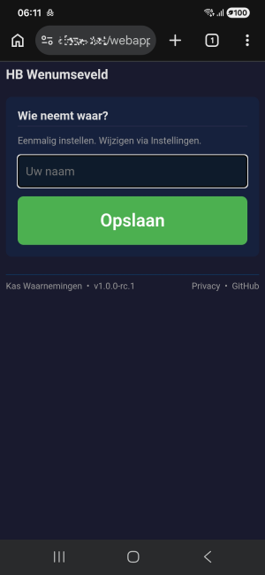

*Figuur 1 — Registratiescherm: invoerveld "Uw naam" met de knop "Opslaan".*

- Vul uw voornaam (of bijnaam) in — maximaal 40 tekens.
- Tik op **Opslaan**.

**Let op:** uw naam is zichtbaar voor de beheerder en wordt gekoppeld aan al uw waarnemingen. Kies een naam die u herkent als uw eigen naam.

**Eenmalig:** u hoeft uw naam maar één keer in te stellen. De volgende keer dat u de app opent, herkent de app u automatisch.

> **Tip:** De app slaat uw identiteit op in een cookie in uw browser. Wist u uw browsergeschiedenis of gebruikt u een privévenster? Dan vraagt de app opnieuw om uw naam.

---

## 3. Het startscherm

Na de registratie (of bij elk volgend bezoek) ziet u het startscherm.

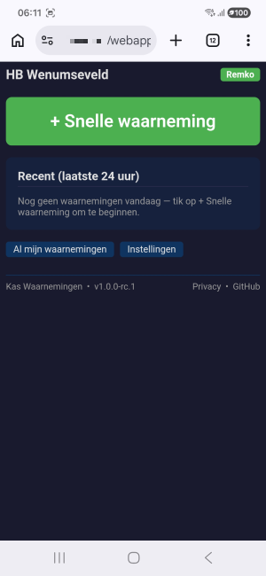

*Figuur 2 — Startscherm: kasnaam bovenaan, knop "+ Snelle waarneming", recente waarnemingen en navigatieknoppen onderaan.*

Het startscherm bevat:

| Element | Uitleg |
|---|---|
| **Kasnaam** bovenaan | De naam van de kas waaraan u gekoppeld bent |
| **+ Snelle waarneming** | De grote knop om direct een nieuwe waarneming in te voeren |
| **Recent (laatste 24 uur)** | Uw waarnemingen van de afgelopen 24 uur, nieuwste bovenaan |
| **Al mijn waarnemingen** | Knop naar uw volledige geschiedenis |
| **Instellingen** | Knop naar uw profiel en privacy-opties |

### Andere kas? Scan opnieuw

Werkt u in meerdere kassen? Scan de QR-code van de andere kas. De app koppelt uw telefoon automatisch aan die kas.

---

## 4. Een waarneming invoeren

Een waarneming invoeren gaat in **twee tikken**.

### Tik 1 — Kies een categorie

Tik op **+ Snelle waarneming**. U ziet een lijst met categorieën.

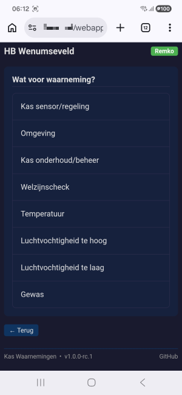

*Figuur 3 — Categoriescherm: de actieve categorieën als grote tikbare rijen.*

Beschikbare categorieën:

| Categorie | Wanneer gebruiken |
|---|---|
| **Welzijnscheck** | Algemene indruk van het gewas of de situatie in de kas |
| **Omgeving** | Licht, lucht, klimaat in de ruimte zelf |
| **Gewas** | Zichtbare toestand van de planten |
| **Sensor/regeling** | Afwijkend gedrag van sensoren of de regelaar |
| **Onderhoud** | Kapotte apparatuur, lekken, storingen |
| **Temperatuur** | Te warm, te koud, vorstschade of groot dag-nachtverschil |
| **Luchtvochtigheid — te hoog** | Condens, schimmel, natrot of smet op vruchten |
| **Luchtvochtigheid — te laag** | Verwelking, bladkrul, verdroging van bloem of vrucht |

Tik op de categorie die het best past bij wat u wilt melden.

### Tik 2 — Kies een tag

U ziet nu de specifieke opties binnen de gekozen categorie.

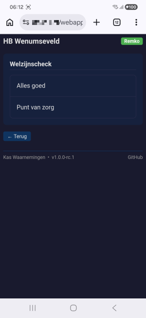

*Figuur 4 — Tagscherm: de tags binnen de gekozen categorie als grote tikbare knoppen.*

Tik op de tag die de situatie het best beschrijft. De waarneming wordt **direct opgeslagen** — u hoeft niet nog eens op een bevestigingsknop te tikken.

> **Tip:** Kies de categorie en tag die het dichtst bij de situatie komen. U kunt daarna altijd nog een opmerking toevoegen voor meer detail.

---

## 5. Het bevestigingsscherm

Na het tikken op een tag ziet u het bevestigingsscherm met een groen vinkje.

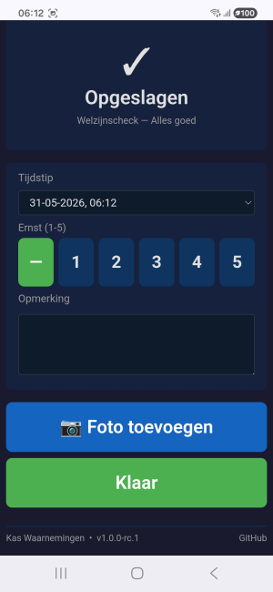

*Figuur 5 — Bevestigingsscherm: groen vinkje bovenaan, optionele velden voor tijdstip, ernst, opmerking en foto, en de knop "Klaar".*

Uw waarneming is nu al opgeslagen. Op dit scherm kunt u optioneel extra informatie toevoegen.

### Tijdstip aanpassen

Het tijdstip is standaard ingesteld op **nu**. Als de situatie al langer geleden was — bijvoorbeeld "zo'n half uur geleden" — pas dan het tijdstip aan door op het tijdstipveld te tikken.

*Figuur 6 — Tijdstipveld met openstaande tijdkiezer.*

### Ernst opgeven

Geef aan hoe ernstig de situatie is op een schaal van 1 tot 5.

| Waarde | Betekenis |
|---|---|
| **—** | Geen ernst opgegeven |
| **1** | Licht — nauwelijks merkbaar |
| **2** | Beperkt — het valt op maar is niet acuut |
| **3** | Gemiddeld — verdient aandacht |
| **4** | Ernstig — snel handelen gewenst |
| **5** | Kritiek — directe actie vereist |

Tik op het gewenste getal. Tik nogmaals op **—** om de ernst te wissen.

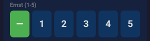

*Figuur 7 — Ernstknoppen: tik op een getal van 1 t/m 5, of op "—" om de ernst te wissen.*

### Opmerking toevoegen

Tik in het opmerkingenveld en typ een korte toelichting. Bijvoorbeeld: *"Linkerhoek van de kas, onderste verdieping, twee planten"*.

### Foto toevoegen

Tik op **📷 Foto toevoegen** om de camera van uw telefoon te openen. Maak een foto of kies er een uit uw galerij.

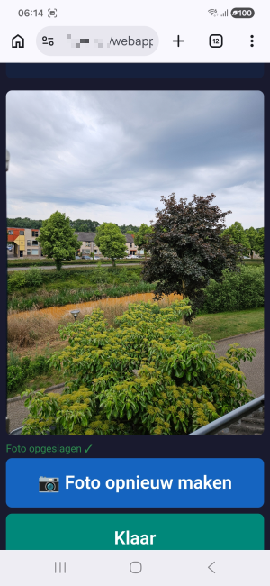

*Figuur 8 — Bevestigingsscherm met fotopreview en de knoppen "📷 Foto opnieuw maken" en "Opslaan".*

- Vind de foto niet goed? Tik op **📷 Foto opnieuw maken**.
- Tevreden? Tik op **Opslaan** — foto en eventuele andere aanvullingen worden opgeslagen.

**Ondersteunde fotoformaten:** JPEG, PNG, WebP · maximaal 8 MB

### Afsluiten zonder aanvullingen

Wilt u geen extra informatie toevoegen? Tik op **Klaar**. U gaat terug naar het startscherm.

> **Tip:** Als u alleen op "Klaar" tikt, blijft de waarneming gewoon opgeslagen — alleen zonder aanvullingen.

---

## 6. Recente waarnemingen bekijken

Op het startscherm ziet u automatisch uw waarnemingen van de **afgelopen 24 uur**, nieuwste bovenaan.

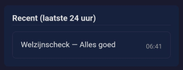

*Figuur 9 — Startscherm met recente waarnemingen, nieuwste bovenaan.*

Iedere regel toont:
- **Categorie — Tag** (bijv. *Temperatuur — Hittestress*)
- Eventueel de ernst: *· 4/5*
- Het tijdstip rechts (bijv. *14:32*)

Tik op een regel om de volledige details te bekijken.

---

## 7. Volledige geschiedenis bekijken

Tik op **Al mijn waarnemingen** op het startscherm voor een overzicht van al uw waarnemingen, gegroepeerd per dag.

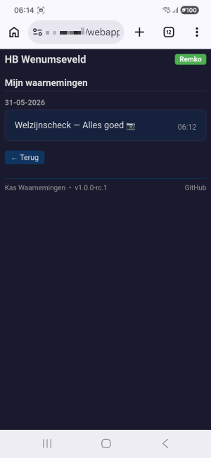

*Figuur 10 — Volledige geschiedenis gegroepeerd per dag; foto's worden aangeduid met een 📷-icoontje.*

- Waarnemingen met een foto hebben een **📷** icoontje.
- Tik op een waarneming om de details te bekijken.
- De lijst gaat terug tot het begin van uw account.

---

## 8. Een waarneming bewerken of verwijderen

Tik op een waarneming (vanuit het startscherm of de geschiedenis) om het detailscherm te openen.

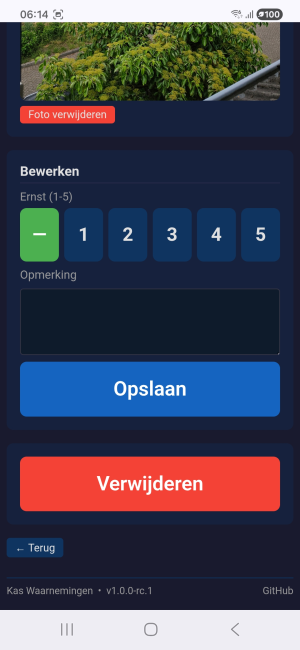

*Figuur 11 — Detailscherm van een waarneming met bewerkformulier en de knoppen "Opslaan" en "Verwijderen".*

### Bewerken

Binnen **24 uur** na het opslaan kunt u een waarneming aanpassen:

- **Ernst** wijzigen via de ernstknoppen
- **Opmerking** aanpassen of aanvullen
- **Foto** toevoegen (als er nog geen foto is)
- **Foto verwijderen** via de knop "Foto verwijderen" (rood)

Tik op **Opslaan** (blauwe knop) om de wijzigingen op te slaan.

### Verwijderen

Tik op **Verwijderen** (rode knop) om de waarneming volledig te wissen. Er verschijnt een bevestigingsvraag — tik op **OK** om door te gaan.

**Let op:** verwijderde waarnemingen kunnen niet worden teruggehaald.

### Na 24 uur

Na 24 uur is de waarneming **alleen-lezen**. U kunt de gegevens dan alleen nog inzien, niet meer wijzigen of verwijderen. Onder de waarneming staat een melding: *"Alleen-lezen na 24 uur."*

> **Tip:** Vergissing gemeld? Voeg zo snel mogelijk een opmerking toe om de context te verduidelijken, terwijl de waarneming nog bewerkbaar is.

---

## 9. Instellingen

Tik op **Instellingen** op het startscherm.

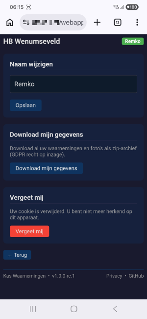

*Figuur 12 — Instellingenpagina met de secties "Naam wijzigen", "Download mijn gegevens" en "Vergeet mij".*

### Naam wijzigen

Wilt u een andere naam gebruiken? Pas de naam aan in het invoerveld en tik op **Opslaan**. Uw eerdere waarnemingen blijven zichtbaar onder de nieuwe naam.

Een naam die al in gebruik is door een andere gebruiker wordt geweigerd — kies dan een andere naam.

### Download mijn gegevens

Tik op **Download mijn gegevens** om een ZIP-bestand te downloaden met:

- Al uw waarnemingen als CSV-bestand (te openen in Excel of Numbers)
- Uw accountgegevens (naam, aanmaakdatum, laatste activiteit)
- Al uw foto's

Dit is uw GDPR-recht op inzage. Het archief wordt direct in uw browser gedownload.

### Vergeet mij

Tik op **Vergeet mij** (rode knop) om uw koppeling met dit apparaat te verbreken.

**Wat gebeurt er?**
- De app herkent dit apparaat niet meer.
- Bij het volgende bezoek vraagt de app opnieuw om een naam.
- Uw eerdere waarnemingen en account **blijven bewaard** in het systeem — ze verdwijnen niet.

Gebruik deze knop als u uw account wilt overdragen aan een ander apparaat, of als u het apparaat doorgeeft aan iemand anders.

---

## 10. Privacy en uw gegevens

- Het enige persoonlijke dat we vastleggen is **de naam die u zelf opgeeft** en een **cookie** op uw telefoon. Geen e-mailadres, geen wachtwoord, geen sociale-media-koppeling.
- Waarnemingen worden bewaard om de regelaar mee te kunnen verbeteren; de standaard-bewaartermijn is **één jaar**. Oudere waarnemingen worden automatisch verwijderd, inclusief de bijbehorende foto's.
- Foto's krijgen automatisch een opschoning van metadata (GPS, camera, tijdstempel) voordat ze opgeslagen worden — dat is goed voor uw privacy.
- U kunt op elk moment uw eigen gegevens als ZIP downloaden via **Instellingen → Download mijn gegevens** (zie §9).
- De volledige uitleg staat op de **Privacy**-pagina, bereikbaar onderaan elk scherm. Daar staat ook hoe u uw rechten kunt uitoefenen.

---

## 11. Contact met de beheerder

Het systeem heeft één beheerder (admin) per installatie. Zij/hij is de contactpersoon voor:

- Een waarneming wijzigen of verwijderen die u zelf niet meer kunt aanpassen (na 24 uur).
- Een vergeten of dubbele naam.
- Storingen, foutmeldingen, een witte pagina, of de app reageert vreemd.
- Het verzoek om al uw gegevens te verwijderen.
- Algemene vragen over wat er met de waarnemingen gebeurt.

De **contactgegevens van de beheerder** vindt u op de **Privacy**-pagina onderaan elk scherm.

---

## 12. Tot slot — over verwachting

Een paar dingen die helpen om dit een nuttig instrument te houden:

- **"Alles goed" is een prima waarneming.** Routineuze "ik liep door de kas, niets bijzonders" is precies wat de analist later wil zien om het normale patroon te kunnen vergelijken met de afwijkingen.
- **Geen enkele waarneming is fout.** Dacht u dat een sensor afweek en bleek het mee te vallen? Die waarneming is alsnog waardevol — nu weten we dat het er in uw ogen *uit zag* alsof er iets aan de hand was. Dat is informatie.
- **Het effect ziet u niet meteen in de app.** Uw waarnemingen worden niet live aan de regelaar teruggekoppeld — die werkt zelfstandig door. De analist neemt uw input mee bij periodieke evaluatie en bijstelling. Dat duurt soms weken. Wees daar niet door teleurgesteld; uw input doet er wél toe.
- **Vlak na de installatie van een nieuwe regelaar wordt er veel ingevoerd**, omdat de regelaar nog niet altijd doet wat gebruikers verwachten. Na een paar weken zakt de inzet vaak — dat is normaal en menselijk. Blijf invoeren wanneer er echt iets te melden valt; dat zijn vaak de waarnemingen die de meeste waarde hebben.
- **Twee tikken is genoeg.** Spendeer niet te veel tijd aan elke registratie. Liever vijf korte waarnemingen dan één perfecte.

Veel succes, en bedankt voor het meekijken in de kas.

---

## 13. Veelgestelde vragen

**Q: Ik heb de app geopend maar ik zie mijn waarnemingen niet meer.**  
A: Uw cookie is mogelijk gewist (na het wissen van browsegegevens, privévenster, of "Vergeet mij"). Open de app opnieuw via de QR-code in de kas en registreer een nieuwe naam. Uw oude waarnemingen zijn nog beschikbaar voor de beheerder.

---

**Q: De app vraagt me opnieuw om een naam, terwijl ik al geregistreerd was.**  
A: Dit gebeurt als uw browsercookie is verwijderd. Dit kan na het wissen van browsegegevens, het gebruik van een privévenster, of na een fabrieksreset van uw telefoon. Registreer gewoon opnieuw met dezelfde naam.

---

**Q: De internetverbinding in de kas is slecht of valt weg. Wat kan ik doen?**  
A: De app vereist actieve internetverbinding om waarnemingen op te slaan. Maak in een kas met slecht internet de waarneming buiten de kas (of waar u wel signaal heeft). **Belangrijk:** leeg of vernieuw uw browser niet wanneer u offline bent — daardoor verliest u uw cookie en kent de app u niet meer. Uw oude naam kunt u niet hergebruiken; u zou opnieuw moeten registreren onder een variant.

---

**Q: Ik heb een verkeerde categorie of tag gekozen. Kan ik dat corrigeren?**  
A: Binnen 24 uur kunt u een waarneming bekijken en aanpassen via het detailscherm. Categorie en tag zelf zijn niet te wijzigen — verwijder de waarneming en maak een nieuwe aan met de juiste keuze.

---

**Q: Ik werk in meerdere kassen. Hoe wisselen?**  
A: Scan de QR-code van de andere kas. De app koppelt uw telefoon automatisch aan die kas. Uw volgende waarneming wordt geregistreerd voor de kas waarvan u als laatste de QR-code heeft gescand.

---

**Q: Kan ik de app ook zonder QR-code openen?**  
A: Ja — als u de directe URL heeft (vraag die op bij de beheerder), kunt u die in uw browser openen. Het is handig om de URL als bladwijzer op te slaan of toe te voegen aan uw startscherm.

---

**Q: Hoe voeg ik de app toe aan mijn beginscherm?**  
A: Open de URL in Safari (iPhone) of Chrome (Android) en kies "Voeg toe aan beginscherm" via het deelmenu (Safari) of de menupunten (Chrome ⋮ → Toevoegen aan startscherm). De app werkt dan als een gewone app-icoon.

---

**Q: Mijn foto is te groot. Wat nu?**  
A: De maximale bestandsgrootte is 8 MB. Maak een nieuwe foto met een lagere resolutie, of gebruik de beeldbewerkingsapp van uw telefoon om de foto te verkleinen.

---

**Q: Wie kan mijn waarnemingen zien?**  
A: Uw waarnemingen zijn zichtbaar voor de beheerder. Andere kasmedewerkers kunnen elkaars waarnemingen **niet** zien via de app. Zie het [privacybeleid](/privacy) voor volledige informatie.

---

**Q: Ik scan de QR-code maar krijg de melding dat de kas gearchiveerd is. Wat betekent dat?**  
A: De beheerder heeft deze kas tijdelijk of definitief uit gebruik genomen. U kunt geen nieuwe waarnemingen registreren voor deze kas. Scan de QR-code van een andere, actieve kas, of neem contact op met de beheerder als u denkt dat dit een fout is.

---

*Vragen of problemen? Neem contact op met de beheerder van de app.*
